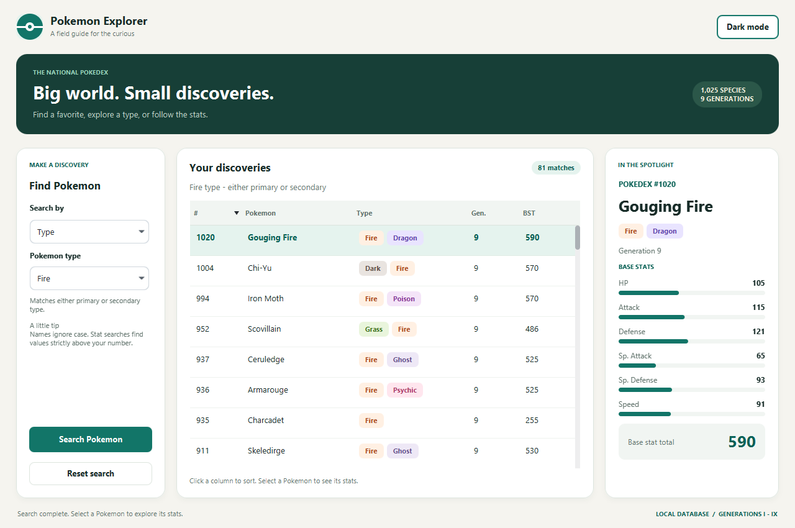

# Pokemon Search

## 1. Project Description

This project uses a SQLite database of Pokemon through Generation IX. Each Pokemon
has a unique Pokedex number, name, generation, one or two types, six base stats,
and a base stat total (BST).

The program lets users explore the database through a repeating console menu.
PokemonDriver reads the user's choices, DBAPI queries the database, and
Pokemon formats the results for display. Users can search repeatedly before
choosing to exit. A JavaFX desktop interface, `PokemonGUI`, provides the same six
searches with an AtlantaFX theme, sortable results, and a detailed stat panel.

The API can answer the following questions:

- Which Pokemon have a particular primary or secondary type?
- Which Pokemon come from a specified generation?
- Which Pokemon matches a full name?
- Which Pokemon has a specified Pokedex number?
- Which Pokemon have a BST greater than a given value?
- Which Pokemon have HP, Attack, Defense, Special Attack, Special Defense, or
  Speed greater than a given value?

Name, type, and stat-name searches ignore case. Threshold searches use a
greater-than comparison, so Pokemon equal to the supplied value are excluded.

## 2. Example Test Run

```text
Find Pokemon by:
1. Type
2. Generation
3. Name
4. Pokedex number
5. Base stat total above a value
6. Individual stat above a value
0. Exit
Choose an option: 6
Enter a stat (HP, Attack, Defense, Special Attack, Special Defense, Speed): hp
Find Pokemon with that stat greater than: 200

Found 3 matching Pokemon:
Chansey (Pokedex #113)
Generation: 1
Type: Normal
Stats:
  HP:              250
  Attack:          5
  Defense:         5
  Special Attack:  35
  Special Defense: 105
  Speed:           50
  Total:           450

Blissey (Pokedex #242)
Generation: 2
Type: Normal
Stats:
  HP:              255
  Attack:          10
  Defense:         10
  Special Attack:  75
  Special Defense: 135
  Speed:           55
  Total:           540

Guzzlord (Pokedex #799)
Generation: 7
Type: Dark / Dragon
Stats:
  HP:              223
  Attack:          101
  Defense:         53
  Special Attack:  97
  Special Defense: 53
  Speed:           43
  Total:           570


Find Pokemon by:
1. Type
2. Generation
3. Name
4. Pokedex number
5. Base stat total above a value
6. Individual stat above a value
0. Exit
Choose an option: 3
Enter the full Pokemon name: lucario

Found 1 matching Pokemon:
Lucario (Pokedex #448)
Generation: 4
Type: Fighting / Steel
Stats:
  HP:              70
  Attack:          110
  Defense:         70
  Special Attack:  115
  Special Defense: 70
  Speed:           90
  Total:           525


Find Pokemon by:
1. Type
2. Generation
3. Name
4. Pokedex number
5. Base stat total above a value
6. Individual stat above a value
0. Exit
Choose an option: 5
Find Pokemon with a base stat total greater than: 700

Found 1 matching Pokemon:
Arceus (Pokedex #493)
Generation: 4
Type: Normal
Stats:
  HP:              120
  Attack:          120
  Defense:         120
  Special Attack:  120
  Special Defense: 120
  Speed:           120
  Total:           720


Find Pokemon by:
1. Type
2. Generation
3. Name
4. Pokedex number
5. Base stat total above a value
6. Individual stat above a value
0. Exit
Choose an option: 0
Goodbye!
```

## 3. AI Usage Statement

I used ChatGPT Codex to help write SQL queries and refactor repeated database query code into a single reusable function. I reviewed the generated code and tested the queries through the program’s menu to check that they returned the expected Pokémon.

## Website Version

A standalone browser version is available in `web/dist/`. It includes all six
search operations, the same Pokemon dataset, sortable and paginated results,
stat details, responsive layouts, and light/dark themes.

Upload the contents of `web/dist/` to a folder on your website, or extract
`web/pokemon-explorer.zip` into that folder. You can preview it by opening
`web/dist/index.html` locally. See [the web README](web/README.md) for instructions.

The website performs searches in JavaScript against a bundled copy of
`data/pokemon.tsv`. It needs no Java or database server and runs independently
of the Java assignment's `DBAPI` and SQLite database.

## Desktop GUI

The desktop app uses [JavaFX](https://openjfx.io/) and the
[AtlantaFX](https://github.com/mkpaz/atlantafx) theme library. It includes all six
database searches, type badges, a sortable results table, base-stat bars, input
validation, and a light/dark theme toggle. Selecting a result displays its full
information in the detail panel. Searches run in the background to keep the
window responsive.



To launch on Windows, macOS, or Linux, **double-click `LaunchPokemon.jar`** in
the project root. Keep it beside `pom.xml` and the `src` folder; it locates the
project even when launched from a different working directory. Your computer
must have Java installed and associate `.jar` files with Java. If double-clicking
opens an archive manager instead, choose **Open With > Java**, or run:

```sh
java -jar LaunchPokemon.jar
```

`LaunchPokemon.java` contains the launcher's source. It detects the operating
system, finds an installed JDK 17+ (including common VS Code, Windows, macOS,
Homebrew, and Linux locations), reuses or downloads Maven, and builds and opens
the GUI. Maven downloads are checked against their SHA-512 checksum. Dependencies
are cached in `.tools` for later runs. The launcher itself supports Java 8+, but
the application still requires an installed JDK 17+. It does not install Java.
The first launch requires internet access and may take a few minutes.

Build output is saved to `.tools/launcher.log`. If launching fails without a
terminal, the launcher attempts to open that log in your default text editor.
To check environment detection or compile without opening the GUI:

```sh
java -jar LaunchPokemon.jar --check
java -jar LaunchPokemon.jar --build-only
```

With JDK 17+ selected, you can also run the Java source directly:

```sh
java LaunchPokemon.java
```

After editing the launcher, rebuild the clickable JAR with a JDK 17+:

```sh
javac --release 8 -encoding UTF-8 -d target/launcher LaunchPokemon.java
jar cfe LaunchPokemon.jar LaunchPokemon -C target/launcher .
```

The original Windows PowerShell launcher is also available:

```powershell
powershell -ExecutionPolicy Bypass -File .\launch-gui.ps1
```

The launcher finds a JDK (Java 17 or newer), including the JDK bundled with the
VS Code Java extension. It downloads Maven and the GUI libraries on the first
run, builds the project, and opens the window. Later runs reuse the cached files
in `.tools`. A JDK must already be installed; if it cannot be found, set
`JAVA_HOME` to its installation directory. The first run requires internet access.

To compile without opening the window:

```powershell
powershell -ExecutionPolicy Bypass -File .\launch-gui.ps1 -BuildOnly
```

With Java 17+ and Maven already configured, the cross-platform alternative is:

```sh
mvn compile javafx:run
```

Run from the project root so `pokemon.db` can be found. If the database is
missing, create it using the existing `CreateDB` instructions below. The console
interface remains available through `PokemonDriver`.

Build and run the console interface without the GUI dependencies:

```powershell
javac -encoding UTF-8 -d bin src/Pokemon.java src/DBAPI.java src/PokemonDriver.java
java --enable-native-access=ALL-UNNAMED -cp "bin;lib/*" PokemonDriver
```

## Development Notes

I used ChatGPT Codex within Visual Studio IDE to import and create a pokemon dataset. The dataset uses pokedex number as key, and includes the name of the pokemon, the type(s) of the pokemon, and the base stats and stat total of the pokemon for all exsting pokemon through generation IX. ChatGPT Codex also posted what operations it performed to the README.


# Pokémon database

`CreateDB` creates a SQLite database with a `pokemon` table and loads the bundled
`data/pokemon.tsv` file. It makes no API calls and needs no internet connection.

From the project root, with Java 17 or newer:

```sh
javac -encoding UTF-8 -d bin src/CreateDB.java
java -cp 'bin:lib/*' CreateDB
```

The default output is `pokemon.db`. To choose another database or data file:

```sh
java -cp 'bin:lib/*' CreateDB /tmp/pokemon.db data/pokemon.tsv
```

The SQLite JDBC driver is included in `lib/`. On Windows, use `bin;lib/*` for the
classpath. Run from the project root so the default data path resolves correctly.

Each row contains a National Pokédex number (the primary key), English species
name, debut generation, required primary type, optional secondary type (`NULL`
for single-type Pokémon), six base stats, and their sum in `stat_total`. These
are base stats, not calculated stats for a particular level or individual.
Rerunning the program updates matching Pokédex numbers without creating duplicates.
Loading happens in one transaction, so a failed import rolls back its changes.

```sql
SELECT pokedex_number, name, primary_type, secondary_type, stat_total
FROM pokemon
ORDER BY pokedex_number;
```

The bundled snapshot includes 1,025 species, #1 Bulbasaur through #1025 Pecharunt,
across Generations I–IX. It was assembled from the
[PokeAPI source data](https://github.com/PokeAPI/pokeapi/tree/master/data/v2/csv)
on October 22, 2026, using `pokemon_species.csv`, `pokemon_species_names.csv`
(English), `pokemon.csv` (default varieties), `pokemon_types.csv`, `types.csv`,
and `pokemon_stats.csv`. Each species uses its default variety's current types
and base stats. Alternate forms, regional forms, and Mega Evolutions do not get
separate rows because they share a National Pokédex number. The snapshot is
local and does not automatically acquire future species or stat changes.
